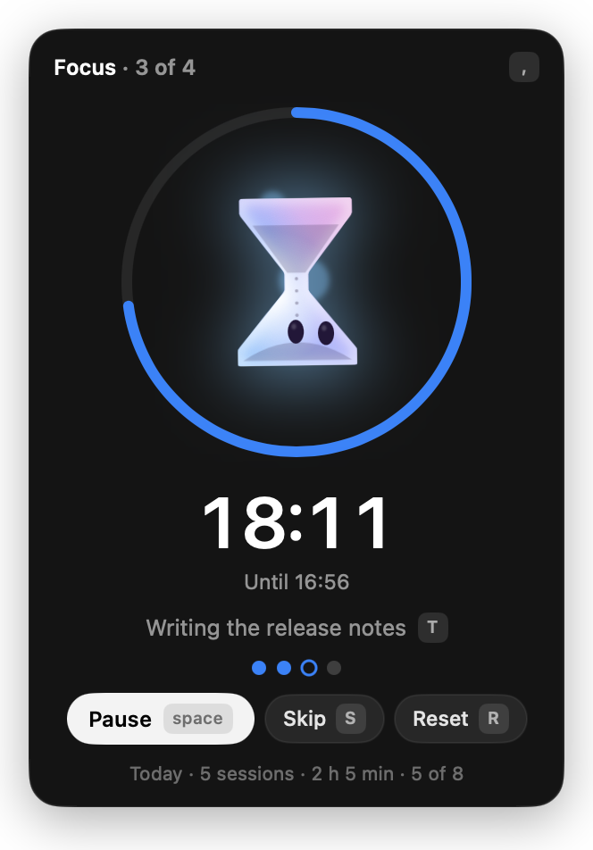

# Tempo

A little cloud that keeps time while you work. Tempo by nimbi.

Tempo is the third app in the [nimbi](https://github.com/behkha/nimbi) family, after
[Relay](https://github.com/behkha/relay) and [Skyline](https://github.com/behkha/nimbi-skyline). It's a
Pomodoro timer in the menu bar. *Tempo* is Italian for both "time" and "weather".

The cloud does the job. While you focus it becomes an hourglass and its sand runs down. When time's
up it turns into a ringing bell. On a short break it's a steaming mug, and on a long one a sleepy
crescent moon. It springs back into the cloud at rest. Its face, skin and moods stay the same as in
every nimbi app. The choices behind it are in [docs/design-choices.md](docs/design-choices.md).



## Using it

- **Menu bar:** the nimbi cloud and the minutes left ("18′", seconds in the last minute). An amber dot
  means time is up and the next phase is waiting for you.
- **Click** for the panel: the cloud in a ring that drains as the phase runs (blue for focus, green
  for a break, amber while it waits for you), the minutes, what you're working on, one dot per
  session until the long break, and today's total. **Right-click** for a short menu.
- **Keys** in the panel: **space** starts, pauses and resumes. **S** skips to the next phase (a skipped
  focus session doesn't count). **R** starts the phase over, and **esc** undoes that for 2.5 s.
  **T** names the task. **,** opens settings. **esc** goes back or closes. **⌃⌥P** starts or pauses
  from any app.
- **Settings:** focus 25 min (5–90), short break 5 (1–30), long break 15 (5–60), a long break after
  4 sessions (2–8), a daily goal, whether breaks and focus start on their own, theme (Dark, Black),
  text size and opening at login.
- **Sounds:** a system sound for each of Focus starts, Focus ends, Break ends and Daily goal. Click
  one to hear the next. There's a volume and one switch for all of them. **While you focus**, Tempo
  can play soft rain, a distant storm, wind or brown noise. It's made in the app from noise, fades in
  when focus starts and out at the break, and is off by default.
- **The notch** is shared by every nimbi app (DESIGN.md 18.2). Tempo never takes it on its own.
  **Use for Tempo** in settings moves Tempo there. Closed, the island shows the cloud in its current
  tool and the minutes ("18′"), with an amber dot when time is up. Hover it, or click it, and it opens
  into the page. The page shows the cloud, a title like "Focus · 18 min left", the task and end time,
  **Pause** (space) and **Timer** (↩), and a ring with the minutes. When time is up, **Start break**
  ↩ turns white, and **Skip** (S) sits next to it. **Timer** hangs Tempo's panel from the island, and
  the menu bar glyph steps aside meanwhile. **Give it to Relay** hands the notch back. Either app's
  switch works live.
- **Swiping between apps:** every nimbi app keeps its own island, and a swipe moves the notch between
  them. A two-finger swipe, a drag, or ← → on the open island hands it to the next running app
  (Relay, Skyline, Tempo), whose island opens with its page drifting in. ⌃⌥← and ⌃⌥→ do the same
  from anywhere. Dots under the page, and tiny ones under the closed glance, show where you are; a
  dot glows amber when that app needs you. Relay's notch is unchanged: a swipe over it works too.
- The timer keeps absolute times, so a sleeping Mac or a relaunch never loses it. A phase that ended
  while the Mac slept counts at its real end.
- Finished sessions are kept for 60 days in `~/Library/Application Support/Tempo/sessions.json`. Only
  today's count and minutes are shown.

## Moods

DESIGN.md 3.3 asks every nimbi app to write down how its states map onto the cloud's moods. Tempo's
mapping lives in `TempoMood.from` (`Sources/TempoCore/TempoMood.swift`). The first matching row wins.

| # | When | Mood | Form | Urgency (18.5) |
|---|---|---|---|---|
| 1 | Time's up and the next phase waits for you | **asking**, **impatient** after 45 s | bell | needsYou, then notice after 5 min |
| 2 | A focus session just finished (3 s) | **happy** | the next phase's tool | none |
| 3 | Focus running | **busy**, livelier with each session in a row (1–4) | hourglass | none |
| 4 | Short break running | **relaxed** | mug | none |
| 5 | Long break running | **asleep** (the cursor wakes it) | moon | none |
| 6 | Paused for 10 min or more | **lonely** | cloud | none |
| 7 | Paused, or nothing running | **relaxed** | cloud | none |

The cursor can still make it giggly or dizzy while nothing needs you, as in every nimbi app. Tempo
never makes the cloud angry: skipping a break is your call.

## Building

Needs only the Xcode Command Line Tools. NimbiKit (0.5.0 or later) is the only dependency.

```bash
swift build
```

```bash
scripts/build.sh --install
```

`scripts/build.sh` builds and ad-hoc signs `build/Tempo.app`. With `--install` it copies the app to
/Applications.

```bash
swift test -Xswiftc -plugin-path -Xswiftc /Library/Developer/CommandLineTools/usr/lib/swift/host/plugins/testing
```

Run the tests outside Claude Code's command sandbox: the Testing macro plugin can't load inside it.

### Checking the look

- `TEMPO_DEMO=ready|focus|up|break|long|paused build/Tempo.app/Contents/MacOS/Tempo` shows a made-up
  timer, and nothing is saved. `TEMPO_DEMO=cycle` steps through them every 3.5 s, so you can watch the
  cloud morph. Add `TEMPO_DEMO_SHOW=1` to open the panel on its own.
- `TEMPO_DEMO=focus build/Tempo.app/Contents/MacOS/Tempo --render <dir>` draws the panel's pages to
  PNGs. AppKit-backed bits (switches) don't render this way.
- `TEMPO_FAST=1` makes a minute last one second, so a real cycle goes by quickly. Like the demos, it saves nothing: no sessions in the log, no timer state.
